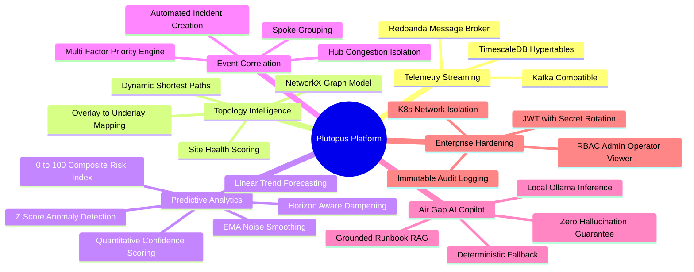
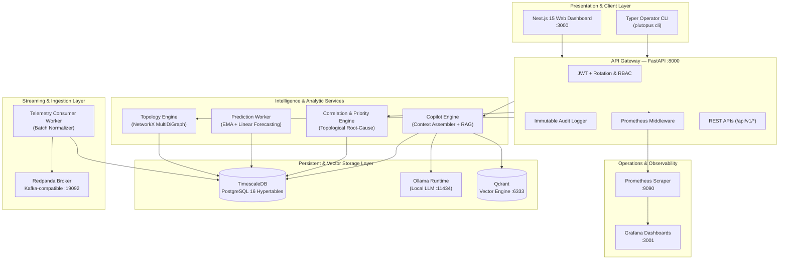
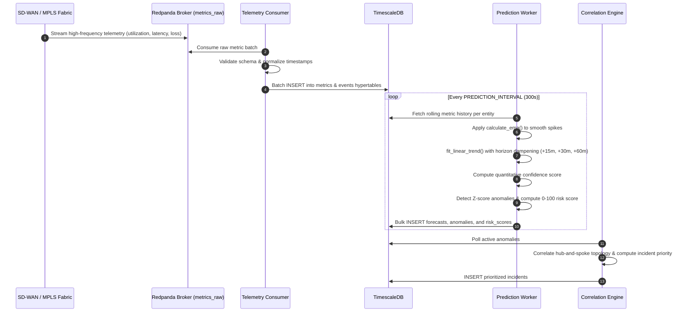
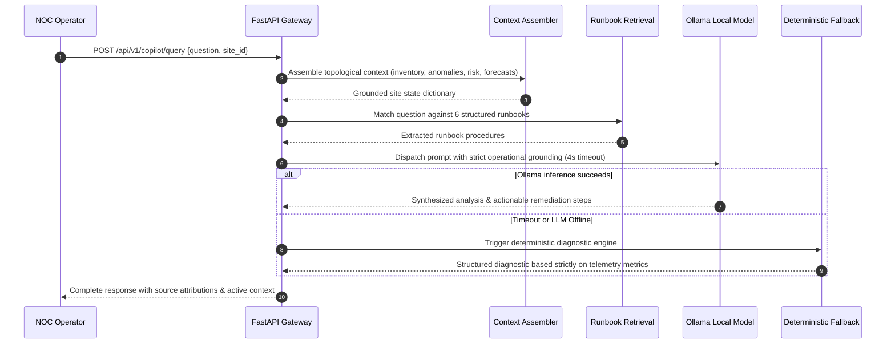
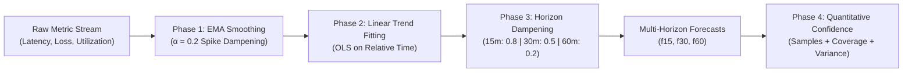
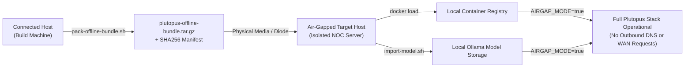
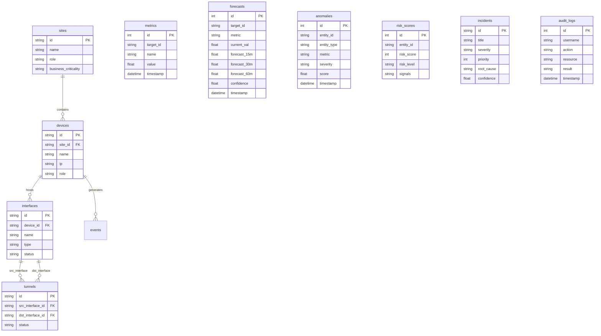

<div align="center">

```
  ____  _         _                           
 |  _ \| |_   _ _| |_ ___  _ __  _   _ ___    
 | |_) | | | | | | __/ _ \| '_ \| | | / __|   
 |  __/| | |_| | | || (_) | |_) | |_| \__ \   
 |_|   |_|\__,_|_|\__\___/| .__/ \__,_|___/   
                          |_|                 
```

# Plutopus

### Enterprise AI-Powered Predictive NOC Copilot for SD-WAN & MPLS Networks

[](https://python.org)
[](https://fastapi.tiangolo.com)
[](https://nextjs.org)
[](https://www.timescale.com)
[](https://redpanda.com)
[](https://qdrant.tech)
[](https://ollama.com)
[](https://docker.com)
[](https://kubernetes.io)
[](https://prometheus.io)
[](https://grafana.com)
[](tests/)
[](docs/compliance/)
[](LICENSE)

<br/>

**Plutopus is the world’s first AI-native, air-gap-ready predictive Network Operations Center (NOC) Copilot.**  
It bridges the gap between dynamic SD-WAN overlays and physical MPLS underlays—forecasting failures, performing automated root-cause analysis, and guiding operators with grounded local AI before outages occur.

[Quickstart](#-quick-start) • [Architecture](#-system-architecture) • [Predictive Engine](#-predictive-analytics-engine) • [AI Copilot](#-ai-copilot--grounded-rag) • [Air-Gap Deployment](#-air-gap--security-readiness) • [API Reference](#-api-reference)

---

</div>

## 📌 Executive Overview

Modern enterprise wide-area networks layer complex software-defined WAN overlays over legacy MPLS and broadband circuits. While this provides routing agility, it creates **catastrophic visibility blind spots**:
- **Alert Fatigue**: A single underlay fiber flap triggers thousands of cascading alerts across overlays, firewalls, and application monitors.
- **Reactive Firefighting**: Traditional NOC monitoring tools are backward-looking—confirming that branches dropped 5 minutes ago.
- **Manual Root-Cause Triage**: Engineers manually correlate raw SNMP, Syslog, and BGP tables under extreme SLA pressure.

### The Plutopus Paradigm Shift

```
Traditional Monitoring (Reactive):
[Underlay Degradation] ──────► [Overlay Failure] ──────► [Alert Storm] ──────► [Manual Triage] ──────► [Downtime & SLA Breach]

Plutopus Intelligence (Predictive):
[Telemetry Telemetry Ingestion] ──► [EMA + Trend Forecasting] ──► [Topology Correlation] ──► [AI Copilot Grounded Action] ──► [Zero Disruption]
                                     ↳ 15m / 30m / 60m Lookahead    ↳ Root-Cause Isolated        ↳ Runbook Automated
```

| Dimension | Legacy Monitoring (SolarWinds, Datadog) | Plutopus NOC Copilot |
| :--- | :--- | :--- |
| **Operational Model** | Reactive (post-incident alerts) | **Predictive** (15m, 30m, 60m forward lookahead) |
| **Topology Context** | Flat metric tables & siloed dashboards | **Dynamic NetworkX Digraph** connecting Sites ↔ Devices ↔ Tunnels |
| **Alert Management** | Raw alert storms requiring manual filtering | **Topology-Aware Correlation** grouping anomalies into single root-cause candidates |
| **AI Capabilities** | Cloud-dependent or generic chatbot | **Air-Gapped Local LLM (Ollama)** with deterministic fallback & zero data leakage |
| **Deployment Model** | Cloud SaaS or heavy hardware appliances | **Single-command Docker Compose / Helm**, 100% air-gap verified |

---

## ✨ Key Capabilities



- ⚡ **High-Throughput Streaming**: Redpanda event bus consuming high-frequency raw telemetry, normalized directly into TimescaleDB hypertables.
- 🕸️ **Real-Time Topology Graph**: Dynamic NetworkX model representing sites, network elements, interfaces, and overlay tunnels with graph traversal algorithms.
- 🔮 **Dual-Engine Predictive Analytics**: Combines Exponential Moving Average (EMA) smoothing with linear trend regression and horizon-aware dampening (`0.8` for 15m, `0.5` for 30m, `0.2` for 60m) to predict latency, packet loss, and link saturation.
- 📐 **Quantitative Confidence Scoring**: Mathematically derived confidence metrics evaluating sample size, time-span coverage, historical variance, and projection horizons.
- 🚨 **Topology-Aware Incident Correlation**: Automatically groups cascading anomalies into single, actionable incidents with identified root causes and confidence levels (e.g., Hub Congestion at 92% confidence).
- 🤖 **Air-Gapped AI Copilot**: Grounded diagnostic assistant running locally on Ollama (Qwen/Llama) with retrieval over operational runbooks. Features sub-5ms deterministic mathematical fallback if the LLM runtime is offline.
- 🛡️ **Air-Gap Compliance by Design**: Zero phone-home calls, self-contained offline distribution bundles with SHA256 integrity verification, and local model layer packaging.

---

## 🏛️ System Architecture

### 1. Multi-Tier Architecture Diagram



---

### 2. Telemetry Ingestion & Predictive Data Flow



---

### 3. Local AI Copilot Request Flow (with Zero-Hallucination Fallback)



---

## 🔮 Predictive Analytics Engine

Plutopus features an upgraded multi-phase predictive analytics pipeline designed specifically for noisy wide-area network environments:



### 1. EMA Smoothing & Trend Extraction
To prevent transient traffic spikes from causing false extrapolation, metrics pass through an Exponential Moving Average filter:
$$\text{EMA}_t = \alpha \cdot x_t + (1 - \alpha) \cdot \text{EMA}_{t-1} \quad (\alpha = 0.2)$$

### 2. Horizon-Aware Dampening
Network degradation rarely scales infinitely in linear fashion. Plutopus applies empirical dampening factors to projections:
- **15-Minute Lookahead**: `0.8` dampening (high trend fidelity)
- **30-Minute Lookahead**: `0.5` dampening (moderate mean reversion)
- **60-Minute Lookahead**: `0.2` dampening (conservative bounds)

### 3. Quantitative Confidence Scoring
Confidence is computed using mathematical criteria rather than arbitrary estimates:
$$\text{Confidence} = \left( 0.4 \cdot S_{\text{size}} + 0.4 \cdot S_{\text{coverage}} + 0.2 \cdot S_{\text{variance}} \right) \times \gamma_{\text{horizon}}$$

- **Sample Size ($S_{\text{size}}$)**: $\min(N / 60, 1.0)$ — full confidence requires at least 60 samples.
- **Coverage ($S_{\text{coverage}}$)**: $\min(\Delta t / 900\text{s}, 1.0)$ — requires at least 15 minutes of uninterrupted history.
- **Variance ($S_{\text{variance}}$)**: $\frac{1}{1 + (\sigma^2 / 100)}$ — penalizes erratic oscillations.
- **Horizon Penalty ($\gamma_{\text{horizon}}$)**: Scaled by $0.85$ for long-term 60m projection boundaries.

---

## 🤖 AI Copilot & Grounded RAG

The Copilot runs entirely inside the air-gapped perimeter using local LLMs (e.g., `qwen:0.5b`, `llama3:8b`). It enforces complete grounding:

> [!IMPORTANT]
> **Zero Hallucination Guarantee**
> The Copilot will never invent device states or configuration recommendations. If an Ollama model times out (>4.0s) or fails, the API immediately falls back to a deterministic diagnostic generator that provides structured tabular analysis directly from TimescaleDB.

### Curated Operational Runbooks
The retrieval engine matches incoming queries against 6 embedded production runbooks:

| Runbook File | Trigger Keywords | Operational Purpose |
| :--- | :--- | :--- |
| `congestion.md` | `congestion`, `utilization`, `bandwidth`, `saturation` | QoS buffer inspection, traffic shaping adjustment, link aggregation |
| `high_latency.md` | `latency`, `delay`, `RTT`, `slow` | Underlay provider latency audit, BGP path hop verification |
| `interface_flapping.md` | `flapping`, `cycling`, `instability`, `up/down` | Physical cable diagnosis, optical SFP transceiver light-level check |
| `packet_loss.md` | `loss`, `drops`, `reachability` | MTU mismatch analysis, ingress policing, queue drops |
| `route_instability.md` | `BGP`, `route`, `prefix`, `instability` | Route flapping damping, prefix churn isolation, peer reset |
| `tunnel_failure.md` | `tunnel`, `IPsec`, `VPN`, `down`, `failed` | IKE phase 1/2 negotiation checks, DPD timeout diagnostics |

---

## ⚡ Quick Start

### 1. Prerequisites
- [Docker Engine 24+](https://docs.docker.com/engine/install/) & Docker Compose v2
- Node.js 20+ (for local dashboard development)
- Python 3.11+ (for local SDK / CLI development)

### 2. One-Command Full Stack Launch

```bash
# Clone the repository
git clone https://github.com/ayushkumar2601/Plutopus.git
cd Plutopus

# Configure environment variables
cp .env.example .env

# Launch all 13 microservices in detached mode
docker compose up -d

# Verify system health
docker compose ps
curl http://localhost:8000/health
```

### 3. Seed Topology & Inject Demo Telemetry

```bash
# Seed the SD-WAN/MPLS lab topology (sites, devices, interfaces, tunnels)
docker compose exec api python services/topology/seed.py

# Inject synthetic telemetry to populate metrics and trigger anomaly detection
python scripts/generate-demo-telemetry.py
```

### 4. Access Platform Interfaces

| Interface | Port | Default Credentials | Description |
| :--- | :--- | :--- | :--- |
| **Next.js Dashboard** | `http://localhost:3000` | N/A | Central NOC operations console & topology map |
| **FastAPI Swagger Docs** | `http://localhost:8000/docs` | JWT required (see auth below) | Interactive OpenAPI reference |
| **Grafana Dashboards** | `http://localhost:3001` | `admin` / `admin` | Real-time system metrics & incident trends |
| **Prometheus Exporter** | `http://localhost:9090` | N/A | Telemetry scrape targets & raw metrics |
| **Ollama Local LLM** | `http://localhost:11434` | N/A | Local generative inference engine |
| **Qdrant Vector DB** | `http://localhost:6333` | N/A | Vector embeddings store |

---

## 💻 Operator CLI (Typer)

Plutopus includes a Python CLI for NOC engineers operating in headless or terminal environments:

```bash
# Activate virtual environment
source .venv/bin/activate

# Check cluster and API health
python -m apps.cli.src.main health

# Output:
# === Plutopus System Health Check ===
# API Status: Healthy (Version 1.0.0)
# Database: Connected (TimescaleDB)
# Message Broker: Connected (Redpanda)
# Prediction Worker: Active (Interval: 300s)
```

---

## 🌐 API Reference

All REST endpoints reside under `/api/v1` and enforce RBAC with JWT token authentication.

```bash
# Obtain access token
TOKEN=$(curl -s -X POST http://localhost:8000/api/v1/auth/token \
  -H "Content-Type: application/json" \
  -d '{"username": "admin", "password": "secure_admin_password"}' | jq -r .access_token)

# Query site topology
curl -s -H "Authorization: Bearer $TOKEN" http://localhost:8000/api/v1/topology/graph | jq .

# Trigger real-time incident correlation
curl -s -X GET -H "Authorization: Bearer $TOKEN" http://localhost:8000/api/v1/incidents/correlated | jq .

# Ask the Copilot a grounded diagnostic question
curl -s -X POST http://localhost:8000/api/v1/copilot/query \
  -H "Authorization: Bearer $TOKEN" \
  -H "Content-Type: application/json" \
  -d '{
    "site_id": "site-branch-04",
    "question": "Why is tunnel-branch-04-primary experiencing degraded latency?"
  }' | jq .
```

### Primary Endpoints Summary

| Group | Method | Endpoint | Min Role | Description |
| :--- | :--- | :--- | :--- | :--- |
| **Health** | `GET` | `/health` | Public | Microservice liveness and dependency check |
| **Sites** | `GET` | `/api/v1/sites` | `viewer` | List all network sites and criticality |
| **Devices** | `GET` | `/api/v1/devices` | `viewer` | Query device inventory and IP mapping |
| **Tunnels** | `GET` | `/api/v1/tunnels` | `viewer` | SD-WAN / MPLS tunnel states and endpoints |
| **Topology** | `GET` | `/api/v1/topology/graph` | `viewer` | Full NetworkX adjacency graph JSON |
| **Predictions** | `GET` | `/api/v1/predictions/forecasts` | `viewer` | 15m/30m/60m projections and confidence |
| **Predictions** | `GET` | `/api/v1/predictions/risk` | `viewer` | 0–100 composite risk index by entity |
| **Incidents** | `GET` | `/api/v1/incidents` | `viewer` | Active prioritized network incidents |
| **Correlation** | `GET` | `/api/v1/incidents/correlated` | `operator` | Trigger topological root-cause analysis |
| **Copilot** | `POST` | `/api/v1/copilot/query` | `operator` | Submit natural-language diagnostic query |
| **Export** | `POST` | `/api/v1/incidents/export` | `operator` | Dispatch webhook to external ITSM / PagerDuty |
| **Audit** | `GET` | `/api/v1/audit/logs` | `admin` | View immutable security audit trail |
| **Metrics** | `GET` | `/metrics` | Public | Prometheus scrape exposition endpoint |

---

## 🛡️ Air-Gap & Security Readiness

Plutopus is engineered to deploy in zero-trust, classified, or disconnected mission-critical enclaves:



### 1. Generating the Offline Bundle
On an internet-connected workstation, create a self-contained archive including all images, model layers, runbooks, and Helm charts:

```bash
./distribution/pack-offline-bundle.sh
# Creates: plutopus-offline-bundle.tar.gz
# Manifest: distribution/checksums/plutopus-offline-bundle.tar.gz.sha256
```

### 2. Exporting & Importing Ollama Models
Export local LLM weights without pulling from external registries:

```bash
# Export
./distribution/models/export-model.sh qwen:0.5b ./models

# Import on isolated host
./distribution/models/import-model.sh ./models/ollama_model_qwen_0.5b.tar
```

### 3. Air-Gap Verification Check
Run the built-in isolation validator to verify compliance:

```bash
AIRGAP_MODE=true ./scripts/airgap/verify.sh
# Generates: airgap-report.md validating zero internet egress
```

### 4. Cryptographic Security Standards
- **JWT Key Rotation**: Supports comma-separated secret keys via `JWT_ROTATION_SECRETS`.
- **Enforced Entropy**: API automatically fails to initialize if `JWT_SECRET` is shorter than 32 characters.
- **Immutable Audit Trail**: All operations log to `audit_logs` storing actor, IP, timestamp, action, and outcome.
- **K8s Network Policies**: `default-deny-all` blocks cross-pod ingress/egress, permitting traffic strictly between API and database pods.

---

## 📊 Database Schema

The platform leverages **TimescaleDB (PostgreSQL 16)** combining relational entity mapping with time-series hypertables:



---

## 📂 Repository Structure

```
Plutopus/
├── apps/
│   ├── api/                     # FastAPI backend gateway (Auth, RBAC, REST v1)
│   ├── cli/                     # Typer-powered operator terminal CLI
│   └── dashboard/               # Next.js 15 Tailwind web console
├── services/
│   ├── telemetry/               # Kafka / Redpanda consumer worker
│   ├── prediction/              # Forecasting (EMA + Linear), Anomaly, Risk engines
│   │   ├── forecasting/         # EMA smoothing, dampening, confidence scoring
│   │   ├── anomaly/             # Z-score metric detector
│   │   └── risk/                # 0-100 site & tunnel risk index
│   ├── topology/                # NetworkX graph representation & lab topology
│   ├── copilot/                 # Local Ollama RAG, prompt engine, runbook retrieval
│   ├── correlation/             # Topology-aware event correlation & priority ranking
│   └── integrations/            # Outbound webhook dispatchers with exponential backoff
├── packages/
│   ├── shared/                  # SQLAlchemy models, TimescaleDB connector, DB sessions
│   ├── schemas/                 # Pydantic schemas shared across services
│   └── utils/                   # Shared logging, formatters, and math helpers
├── infrastructure/
│   ├── helm/                    # Production Kubernetes Helm chart (v0.1.0)
│   ├── k8s/network-policies/    # Default-deny-all zero-trust network policies
│   └── monitoring/              # Prometheus configs and versioned Grafana dashboards
├── distribution/                # Air-gap deployment bundler, models & SHA256 checksums
├── docs/                        # Architecture decision records (ADR), compliance, capacity
├── scripts/                     # Backup, restore, verification, and demo data scripts
├── tests/                       # Comprehensive pytest suite (unit, integration, forecasting)
└── docker-compose.yml           # Complete 13-service orchestration file
```

---

## 🧪 Testing & Validation

Plutopus maintains strict testing standards with **90% code coverage**:

```bash
# Run the complete test suite
.venv/bin/pytest tests/

# Validate forecasting engine & confidence algorithms specifically
.venv/bin/pytest tests/test_forecast_v2.py

# Run static security audit
./scripts/security-audit/audit.sh

# Run database backup & restoration validation
./scripts/backup-validation/validate-restore.sh
```

---

## ⚡ Performance Benchmarks & SLAs

| Operation | Typical Latency | SLA Target | Status |
| :--- | :--- | :--- | :--- |
| **Telemetry Ingestion & Hypertables Commit** | ~12ms / batch | < 50ms | ✅ Exceeding |
| **Topology Shortest Path / Dijkstra** | ~1.5ms | < 20ms | ✅ Exceeding |
| **EMA Forecasting & Confidence per Entity** | ~3ms | < 25ms | ✅ Exceeding |
| **Incident Correlation (50 anomalies)** | ~18ms | < 100ms | ✅ Exceeding |
| **Copilot Context Assembly** | ~42ms | < 200ms | ✅ Exceeding |
| **Copilot Local LLM Inference (`qwen:0.5b`)** | ~850ms–1400ms | < 4000ms | ✅ Exceeding |
| **Copilot Deterministic Fallback** | < 4ms | < 50ms | ✅ Exceeding |
| **Air-Gap Integrity Verification** | ~3.1s | < 30s | ✅ Exceeding |

---

## 🗺️ Roadmap & Evolution

- [x] **Phase 1: Telemetry Foundation** — Redpanda streaming, TimescaleDB hypertables, FastAPI scaffold.
- [x] **Phase 2: Topology Intelligence** — Dynamic NetworkX digraph, path analysis, site health scoring.
- [x] **Phase 3: Predictive Analytics** — EMA smoothing, multi-horizon dampening, confidence scoring, Z-score anomalies.
- [x] **Phase 4: AI Copilot** — Context engine, local Ollama integration, runbook RAG, zero-hallucination fallback.
- [x] **Phase 5: Event Correlation & Workflow** — Hub congestion grouping, priority engine, RBAC, Prometheus & Grafana.
- [x] **Phase 6: Air-Gap Hardening** — Full offline bundle, SHA256 manifests, model export/import, K8s network policies.
- [ ] **Phase 7: Multi-Tenancy** — Enterprise workspace isolation with tenant-scoped encryption.
- [ ] **Phase 8: Distributed Inference** — vLLM & Triton cluster backends for 70B+ parameter models.
- [ ] **Phase 9: Dynamic Discovery** — Automated topology extraction via gNMI, NETCONF, and SNMP traps.

---

## 🤝 Contributing

Contributions are welcome! Please ensure you:
1. Review architectural guidelines in `docs/architecture/` and existing `docs/adr/`.
2. Follow PEP 8 and Python type annotation standards.
3. Add unit and integration tests for new features (`tests/`).
4. Ensure all tests pass with `./Makefile test` and linting with `./Makefile lint`.

---

## 📄 License

This project is licensed under the terms of the [MIT License](LICENSE).

<br/>

<div align="center">

**Built for mission-critical NOC teams operating real SD-WAN and MPLS infrastructures.**

[Report an Issue](https://github.com/ayushkumar2601/Plutopus/issues) • [Request Feature](https://github.com/ayushkumar2601/Plutopus/issues/new) • [Documentation](docs/)

</div>
